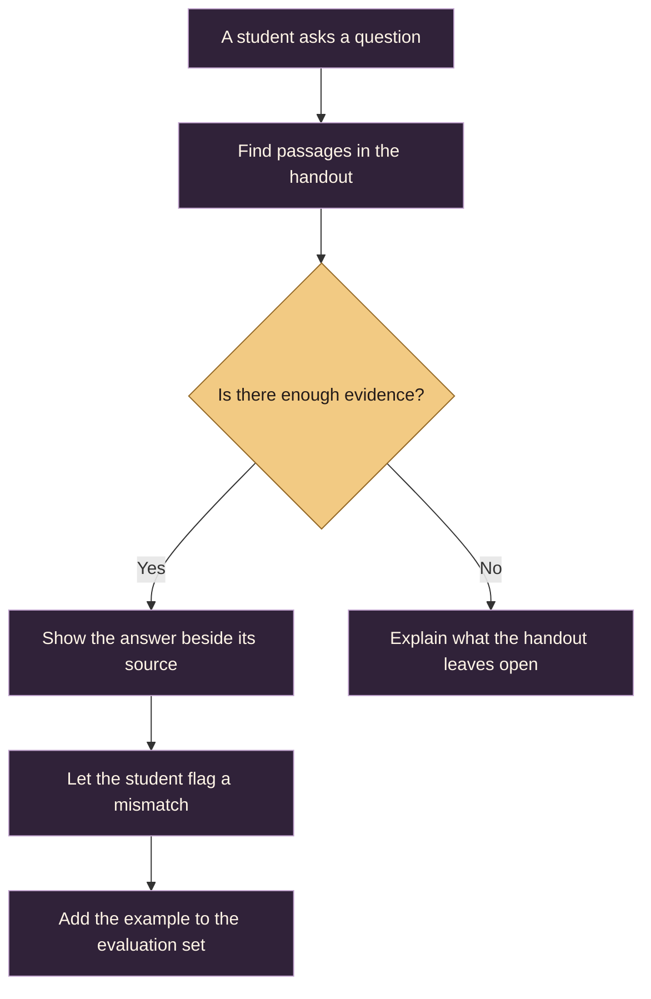

  

  <a href="#profile"><strong>Profile</strong></a>
  &nbsp; / &nbsp;
  <a href="#research"><strong>Research</strong></a>
  &nbsp; / &nbsp;
  <a href="#studio"><strong>Project studio</strong></a>
  &nbsp; / &nbsp;
  <a href="#toolkit"><strong>Toolkit</strong></a>
  &nbsp; / &nbsp;
  <a href="#connect"><strong>Contact</strong></a>

---

<table>
<tr>
<td width="63%" valign="middle">

<strong>PERSONAL PROFILE &nbsp; / &nbsp; NEPAL 🇳🇵</strong>

<h2>Namaste, I’m Sushil.</h2>

I’m a computer science student at <strong>Xavier International College in Nepal</strong>, working toward a career in AI engineering.

I’m interested in what happens between a model making a prediction and a person deciding to trust it. An internship recommendation, for example, is only useful if the student is eligible, the deadline is open, and the role gives them a chance to use what they know.

That question brings together my interests in <strong>machine learning, web development, and digital opportunity for young people in Nepal.</strong>

  <a href="https://github.com/Sushil25742?tab=repositories"><strong>Explore my code ↗</strong></a>
  &nbsp; · &nbsp;
  <a href="https://www.kaggle.com/sushil1j"><strong>Find me on Kaggle ↗</strong></a>

</td>
<td width="37%" align="center" valign="middle">

 
<strong>Boudhanath · Kathmandu, Nepal</strong>
 
Photo by <a href="https://commons.wikimedia.org/wiki/File:Boudhanath_Stupa,_Kathmandu_-2026.jpg">Jeena Maharjan</a> · <a href="https://creativecommons.org/licenses/by-sa/4.0/">CC BY-SA 4.0</a>

</td>
</tr>
</table>

## What I’d like to research

> ### Which digital skills help a student in Nepal get their first real opportunity?

A job listing, a college assignment, and a student portfolio can all mention **Python** and mean three different things. One might ask for data analysis, another for an algorithm, and another for a working website. I’d like to study the tasks behind those labels.

| Who I’d ask | The question I’d start with |
| :--- | :--- |
| **A student** | What did you learn in class that you later used without being given step-by-step instructions? |
| **An educator** | Which part of a project shows you that a student understands their own solution? |
| **An employer** | What would you want to see in a beginner’s repository before inviting them for an interview? |

I’d want the result to be useful to someone choosing their next project. “Build a tool that cleans a messy spreadsheet and explains what changed” gives a student a clearer place to begin than “learn data science.”

## Project studio

Two experiments I’d like to build. Each starts with a question small enough to test.

<table>
<tr>
<td width="50%" valign="top">

<h3>A skills map for first jobs</h3>

What do entry-level technical roles in Nepal actually ask a beginner to do?

I’d start with a dated sample of public job listings. For each one, I’d record the role, the task, and whether a skill is required or preferred. Visitors could select a skill and read the original sentence where the employer mentions it.

<strong>First deliverable</strong> A searchable chart backed by a small, documented dataset.

PYTHON &nbsp;·&nbsp; SQL &nbsp;·&nbsp; DATA VISUALIZATION

</td>
<td width="50%" valign="top">

<h3>A study assistant that shows its sources</h3>

Can a student check an AI explanation against the course handout it came from?

I’d begin with one handout and a set of student questions. Each answer would sit beside the passage that supports it. Some questions would deliberately ask about material the handout never covers.

<strong>First deliverable</strong> A side-by-side answer and source viewer with a small evaluation set.

PYTHON &nbsp;·&nbsp; RETRIEVAL &nbsp;·&nbsp; WEB DEVELOPMENT

</td>
</tr>
</table>

<strong>Open the design sketch for the study assistant ↓</strong>

 

**The test I’d run first:** Give it a question whose answer appears word-for-word in the handout, one that needs two passages, and one the handout cannot answer. Those three cases would tell me more about the first version than a polished demo alone.

## Technical toolkit

| Area | Tools and interests |
| :--- | :--- |
| **Programming** | Python, JavaScript, Java, C, data structures, and algorithms |
| **Machine learning** | PyTorch, TensorFlow, model evaluation, and error analysis |
| **Web and data** | HTML, CSS, Node.js, MySQL, and Firebase |
| **Cloud and delivery** | Exploring AWS, Azure, Google Cloud, Netlify, and MLOps |
| **Design and development** | Figma, VS Code, Git, and GitHub |

<strong>What I’m learning next ↓</strong>

 

**Deep learning.** I want to get comfortable tracing one example through a training loop and explaining how the prediction, loss, and parameter update fit together.

**MLOps.** My next milestone is a small model I can package, deploy, and test again after changing its inputs. I’m particularly interested in catching differences between how data is prepared during training and how it arrives in an application.

**Research methods.** I’m learning how to turn a broad question about digital skills into an interview guide or a dataset that can support a specific conclusion.

## A note from the workbench

### The model with 95% accuracy that finds zero internships

Imagine a collection of **100 internship listings**. Five suit a particular student. A model marks every listing as irrelevant.

| What happened | Listings |
| :--- | ---: |
| Unsuitable listings correctly filtered out | 95 |
| Suitable listings shown to the student | 0 |
| Suitable listings the student never sees | 5 |

<strong>How can the accuracy still be 95%?</strong>

 

The model gets 95 of its 100 decisions right. But the student opened the tool to find an opportunity, and every useful opportunity disappeared.

For this example, I’d track **recall** alongside accuracy. Of the five relevant listings available, the model found zero. If the interface displayed a ranked list, I’d also inspect its first five results, because those are the recommendations the student would actually see.

That’s one reason I’m drawn to applied machine learning. Choosing what to measure can be just as interesting as choosing what to train.

## GitHub activity

[Browse repositories ↗](https://github.com/Sushil25742?tab=repositories) &nbsp;·&nbsp; [Explore my starred projects ↗](https://github.com/Sushil25742?tab=stars)

## Let’s compare notes

If you’ve built your first ML project, **what was the first example that made you rethink your model?** I’d love to hear the story. I’m also interested in comparing notes with students and researchers studying digital skills in Nepal.

  
  

[Instagram](https://www.instagram.com/sushil1t/) &nbsp;·&nbsp; [X](https://x.com/sushilsah288149) &nbsp;·&nbsp; [Facebook](https://www.facebook.com/sushil1rs) &nbsp;·&nbsp; [TikTok](https://www.tiktok.com/@sushil1r)

<a href="#top">Back to top ↑</a>

