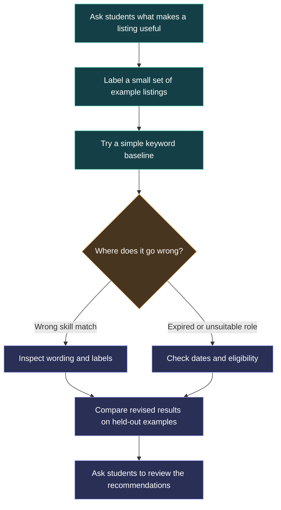

  

<h1 align="center">Hi 👋, I’m Sushil Kumar Sah</h1>

  <strong>Computer Science Student &nbsp;·&nbsp; Aspiring AI Engineer &nbsp;·&nbsp; Nepal 🇳🇵</strong>

  

  
  
  

  <a href="#about-me">About me</a> &nbsp;·&nbsp;
  <a href="#ai-workbench">AI workbench</a> &nbsp;·&nbsp;
  <a href="#toolkit">Toolkit</a> &nbsp;·&nbsp;
  <a href="#experiments">Experiments</a> &nbsp;·&nbsp;
  <a href="#activity">Activity</a> &nbsp;·&nbsp;
  <a href="#connect">Connect</a>

---

## 👨‍💻 About me

I’m **Sushil**, a computer science student at **Xavier International College in Nepal**. I work with Python, JavaScript, and Java, and I’m learning how to take a machine learning idea from a notebook to an application someone can actually use.

I’m especially interested in the moment a model gets something wrong. Was the example unusual? Was the label unclear? Did I ask the wrong question in the first place? Those questions bring together the parts of computer science I enjoy most: writing code, investigating data, and figuring out what an answer actually means.

| 🎓 Studying | 🧠 Exploring | 🌏 Research interest |
| :--- | :--- | :--- |
| Computer science at Xavier International College | Deep learning, generative AI, and MLOps | Digital skills and employment opportunities for young people in Nepal |

## 🔬 My AI workbench

**Suppose I wanted to build a tool that helps students find relevant internships.** Before choosing a model, I’d want to know what *relevant* means. A listing might match a student’s Python skills perfectly and still be a poor recommendation because the deadline has passed or the role requires experience they don’t have.

Here’s how I’d approach that experiment.

The comparison I’d care about most is how often a student finds a listing worth applying to in the first five results. That gives me something concrete to improve and a reason to ask students what the ranking missed.

## 🛠️ Technical toolkit

### Languages

  

**Python** for data and machine learning · **JavaScript** for the web · **Java and C** for core programming and algorithms

### Machine learning, web, and data

  

I’m exploring the connection between these tools: how a prediction produced in Python becomes something a person can see, use, and give feedback on in a web application.

<strong>☁️ Open my cloud and developer toolbox</strong>

 

| Area | Tools |
| :--- | :--- |
| Cloud platforms I’m exploring | AWS, Microsoft Azure, Google Cloud |
| Web hosting | Netlify |
| Version control | Git, GitHub |
| Interface design and development | Figma, VS Code |

## 🧪 Three experiments I’d like to build

Each idea starts with a small enough question to test. Open whichever one interests you.

<strong>📊 01 · What skills appear in entry-level job listings in Nepal?</strong>

### The question

If a student had one semester to learn a new technical skill, what evidence could help them choose?

### A first version

I’d start with a dated sample of public entry-level listings and record the role, location, and skills each employer mentions. I’d keep **required** and **preferred** skills separate. A student reading the results should be able to tell whether SQL is a requirement for a role or simply a bonus.

### What I’d show

A chart of the most frequently requested skills, a filter by role, and a link back to each original listing. I’d also show the sample size. Ten listings from Kathmandu and a hundred listings from across Nepal answer different questions.

<strong>🤖 02 · Can a study assistant point to the paragraph behind its answer?</strong>

### The question

Could a student use a course handout to check an AI-generated explanation for themselves?

### A first version

I’d use one handout, a small set of questions, and a simple interface. Each answer would appear beside the passage used to produce it. I’d include questions the handout cannot answer and check whether the assistant recognizes the missing information.

### What I’d measure

Can a reader find the supporting passage? Does it actually support the answer? How often does the assistant answer confidently when the handout is silent?

<strong>☁️ 03 · What changes between a working notebook and a reliable demo?</strong>

### The question

A prediction works on my laptop. What happens when someone submits a blank field, a new category, or an input format I didn’t anticipate?

### A first version

I’d package a small prediction model behind a web form and give it a set of deliberately awkward inputs. For each one, I’d record what the visitor saw and whether they could recover without help.

### What I’d learn

How to validate inputs, keep training and prediction steps consistent, and write an error message that tells someone what they can do next.

## 🇳🇵 A research question close to home

> **Which digital skills help young people in Nepal move from completing a course to finding an opportunity where they can use what they learned?**

I’d like to look at this question from three perspectives.

| Perspective | What I’d ask |
| :--- | :--- |
| 🎓 **Students** | Which skills have you had a chance to use outside an assignment? |
| 🏫 **Educators** | What kind of project helps you see whether a student can work independently? |
| 💼 **Employers** | What would you need to see in a beginner’s portfolio to invite them for an interview? |

I’d be particularly interested in where the answers differ. A student might be proudest of training a model, while an employer wants to hear how they noticed a data problem. That difference could make for a useful classroom project.

## 💡 A sixty-second ML puzzle

A dataset contains **100 internship listings**. Only **5** are relevant to a particular student. A model marks every listing as *irrelevant* and reports **95% accuracy**.

**Would you trust it to recommend an internship?**

<strong>Reveal what the score hides ↓</strong>

The model correctly rejected 95 irrelevant listings, so its accuracy really is **95%**. But it missed **all five** relevant listings. Its recall for relevant opportunities is **0 out of 5**.

For a recommendation tool, I’d also look at the first few results a student actually sees. A useful next question is: **Of the five listings we put at the top, how many would this student consider applying to?**

## 📈 On GitHub

  

  <a href="https://github.com/Sushil25742?tab=repositories"><strong>Browse my repositories ↗</strong></a>
  &nbsp;·&nbsp;
  <a href="https://github.com/Sushil25742?tab=stars">See what I’m bookmarking ↗</a>

## 📚 Learning shelf

A few places to start if you’re exploring similar topics.

| If you want to… | Start here |
| :--- | :--- |
| Practice Python and data analysis in short exercises | [Kaggle Learn](https://www.kaggle.com/learn) |
| Follow a neural network from tensors through training and saving | [PyTorch · Learn the Basics](https://docs.pytorch.org/tutorials/beginner/basics/intro.html) |
| Understand how data leakage can make a model look better than it is | [scikit-learn · Common Pitfalls](https://scikit-learn.org/stable/common_pitfalls.html) |
| Explore tokenizers, transformers, and language models | [Hugging Face · LLM Course](https://huggingface.co/learn/llm-course/chapter1/1) |

## 🌐 Let’s connect

If you’re a student in Nepal, **what’s one digital skill you wish you’d learned earlier, and where would you have used it?** I’d be interested in hearing your answer. I’d also love to exchange ideas about beginner-friendly ML projects, useful datasets, and ways to make research accessible to students.

  
  
  
  
  
  

